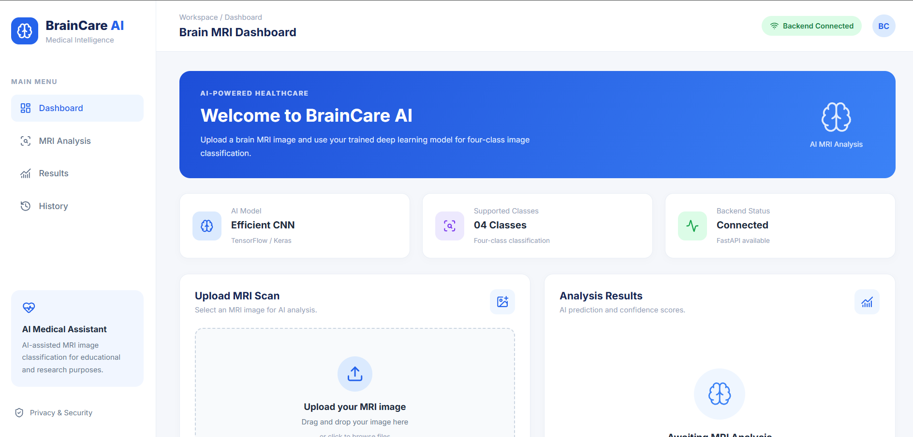
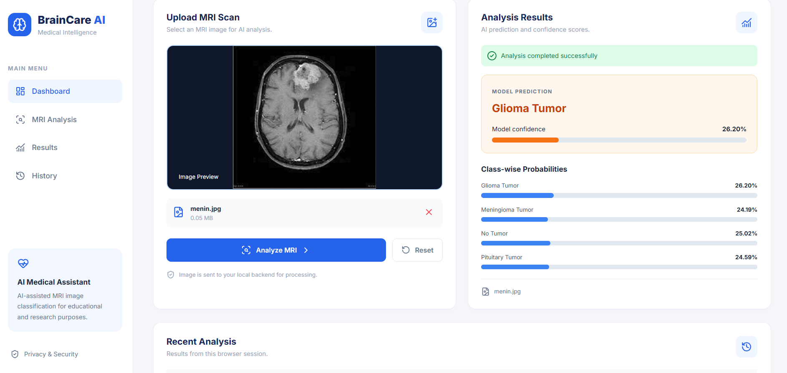
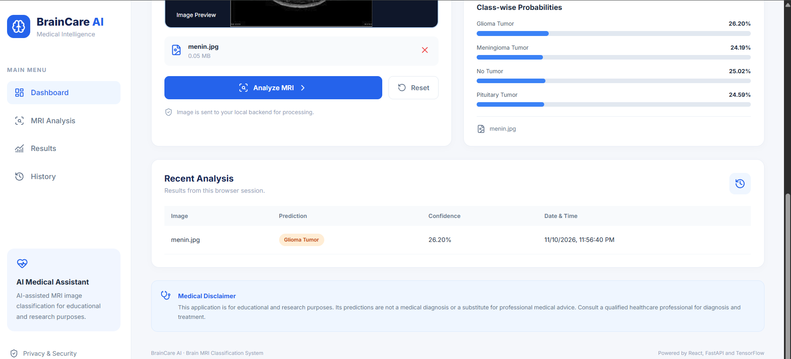

<!-- ================== PROJECT HEADER ================== -->

<h1 align="center">🧠 BrainCare AI</h1>

<h3 align="center">
  AI-Powered Brain Tumor Detection System Using MRI Images
</h3>

  An intelligent web application that analyzes brain MRI images
  and classifies them into four categories using a trained deep learning model.

  
  
  
  

  

<!-- ================== PROJECT OVERVIEW ================== -->

<h2>📌 Project Overview</h2>

  <b>BrainCare AI</b> is an AI-powered brain MRI image classification
  system designed to identify different brain tumor categories using
  a trained deep learning model.

  The application provides a modern and interactive dashboard where
  users can upload MRI images, preview scans, and receive AI-generated
  classification results with model confidence scores and class-wise
  probability distributions.

  The project uses a <b>React frontend</b>, a <b>FastAPI backend</b>,
  and a trained <b>TensorFlow/Keras model</b> for image classification.

<h3>🎯 Supported Classification Categories</h3>

<ul>
  <li>🟣 Glioma Tumor</li>
  <li>🔵 Meningioma Tumor</li>
  <li>🟡 No Tumor</li>
  <li>🟢 Pituitary Tumor</li>
</ul>

<!-- ================== SCREENSHOTS ================== -->

<h2>🖥️ Application Screenshots</h2>

<h3>1. BrainCare AI Dashboard</h3>

  

  <i>Modern dashboard displaying backend connection, model information,
  MRI upload section, and analysis results.</i>

 

<h3>2. MRI Image Analysis and Prediction</h3>

  

  <i>MRI image preview, predicted tumor category, model confidence,
  and class-wise probability scores.</i>

 

<h3>3. Analysis History</h3>

  

  <i>Recent analysis results with prediction, confidence score,
  and date and time.</i>

<!-- ================== KEY FEATURES ================== -->

<h2>✨ Key Features</h2>

<ul>
  <li>🧠 AI-powered brain MRI image classification.</li>
  <li>📤 Upload MRI images from local storage.</li>
  <li>🖼️ Preview MRI images before analysis.</li>
  <li>⚡ Fast image processing through FastAPI.</li>
  <li>📊 Model confidence score visualization.</li>
  <li>📈 Class-wise probability distribution.</li>
  <li>🔄 Recent analysis history.</li>
  <li>🔌 Real-time backend connection status.</li>
  <li>📱 Responsive and modern dashboard interface.</li>
</ul>

<!-- ================== TECHNOLOGY STACK ================== -->

<h2>🛠️ Technologies Used</h2>

<h3>Frontend Development</h3>

<ul>
  <li><b>React.js:</b> Building the interactive user interface.</li>
  <li><b>Vite:</b> Frontend development and build tool.</li>
  <li><b>JavaScript:</b> Application functionality.</li>
  <li><b>CSS:</b> Dashboard styling and responsive design.</li>
  <li><b>Lucide React:</b> UI icons.</li>
</ul>

<h3>Backend Development</h3>

<ul>
  <li><b>Python:</b> Backend programming.</li>
  <li><b>FastAPI:</b> REST API development.</li>
  <li><b>Uvicorn:</b> Backend server.</li>
  <li><b>TensorFlow / Keras:</b> Deep learning model loading and inference.</li>
  <li><b>Pillow:</b> Image processing.</li>
</ul>

<h3>Artificial Intelligence</h3>

<ul>
  <li>Deep Learning</li>
  <li>Image Classification</li>
  <li>Image Preprocessing</li>
  <li>Four-Class MRI Classification</li>
</ul>

<!-- ================== PROJECT STRUCTURE ================== -->

<h2>📂 Project Structure</h2>

<pre>
brain-tumor-detection-ml/
│
├── backend/
│   ├── main.py
│   ├── brain_tumor_model.h5
│   └── requirements.txt
│
├── frontend/
│   ├── public/
│   ├── src/
│   │   ├── assets/
│   │   ├── App.jsx
│   │   ├── App.css
│   │   ├── index.css
│   │   └── main.jsx
│   ├── package.json
│   └── vite.config.js
│
├── docs/
│   └── screenshots/
│       ├── dashboard.png
│       ├── prediction-result.png
│       └── analysis-history.png
│
├── .gitignore
└── README.md
</pre>

<!-- ================== INSTALLATION ================== -->

<h2>⚙️ Installation and Setup</h2>

<h3>Step 1: Clone the Repository</h3>

<pre>
git clone https://github.com/Nishuyeole12/brain-tumor-detection-ml.git

cd brain-tumor-detection-ml
</pre>

<h3>Step 2: Setup Backend</h3>

Create a Python virtual environment:

<pre>
python -m venv venv
</pre>

Activate the virtual environment on Windows:

<pre>
venv\Scripts\Activate.ps1
</pre>

Install backend dependencies:

<pre>
pip install -r backend/requirements.txt
</pre>

Start the FastAPI server:

<pre>
python -m uvicorn backend.main:app --reload --port 8000
</pre>

<b>Backend URL:</b>

<pre>
http://127.0.0.1:8000
</pre>

<b>API Documentation:</b>

<pre>
http://127.0.0.1:8000/docs
</pre>

<h3>Step 3: Setup Frontend</h3>

Open a new terminal and navigate to the frontend folder:

<pre>
cd frontend
</pre>

Install frontend dependencies:

<pre>
npm install
</pre>

Run the React application:

<pre>
npm run dev
</pre>

Open the URL provided by Vite, usually:

<pre>
http://localhost:5173
</pre>

<!-- ================== APPLICATION WORKFLOW ================== -->

<h2>🔄 Application Workflow</h2>

<ol>
  <li>User opens the BrainCare AI dashboard.</li>
  <li>User uploads a brain MRI image.</li>
  <li>The selected image is displayed in the preview section.</li>
  <li>User clicks the <b>Analyze MRI</b> button.</li>
  <li>React sends the image to the FastAPI backend.</li>
  <li>Backend preprocesses the uploaded MRI image.</li>
  <li>The trained TensorFlow/Keras model performs classification.</li>
  <li>The predicted category and class-wise probabilities are returned.</li>
  <li>Results are displayed on the dashboard.</li>
</ol>

<!-- ================== API INFORMATION ================== -->

<h2>🔌 API Information</h2>

<table>
  <tr>
    <th>Method</th>
    <th>Endpoint</th>
    <th>Description</th>
  </tr>
  <tr>
    <td>GET</td>
    <td><code>/</code></td>
    <td>Check backend status</td>
  </tr>
  <tr>
    <td>POST</td>
    <td><code>/predict</code></td>
    <td>Upload MRI image and receive prediction</td>
  </tr>
</table>

<!-- ================== FUTURE ENHANCEMENTS ================== -->

<h2>🚀 Future Enhancements</h2>

<ul>
  <li>Cloud deployment and hosting.</li>
  <li>Doctor and patient management dashboard.</li>
  <li>Secure user authentication.</li>
  <li>Persistent patient analysis history.</li>
  <li>Detailed MRI analysis reports.</li>
  <li>Additional deep learning model improvements.</li>
</ul>

<!-- ================== MEDICAL DISCLAIMER ================== -->

<h2>⚠️ Medical Disclaimer</h2>

  BrainCare AI is developed strictly for <b>educational and research
  purposes</b>. The model predictions are not medical diagnoses and
  should not be used as a substitute for professional medical advice,
  radiological examination, or treatment.

  Always consult a qualified healthcare professional for medical
  evaluation and decisions.

<!-- ================== AUTHOR ================== -->

<h2>👨‍💻 Author</h2>

  <b>Nishikant Yeole</b> 
  AI & Machine Learning | Software Development

  🔗 GitHub:
  <a href="https://github.com/Nishuyeole12" target="_blank">
    Nishuyeole12
  </a>

  ⭐ If you find this project interesting, please consider giving
  this repository a star!

<h3 align="center">Built with ❤️ using AI and Modern Web Technologies</h3>
